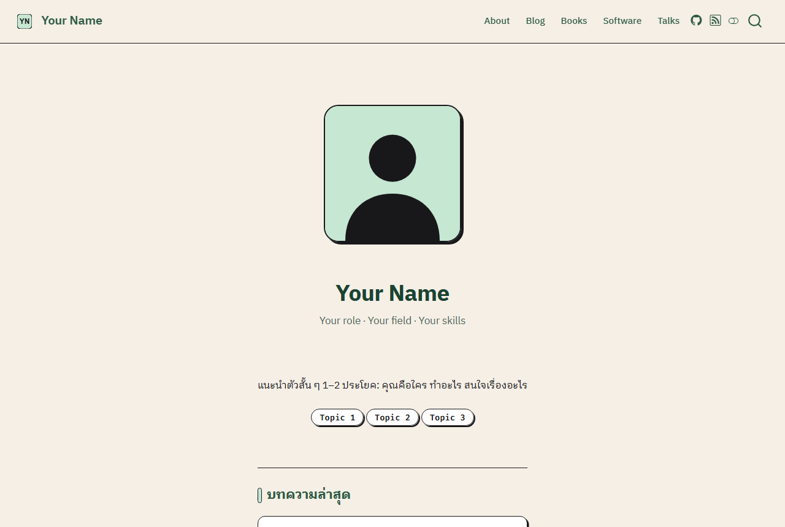
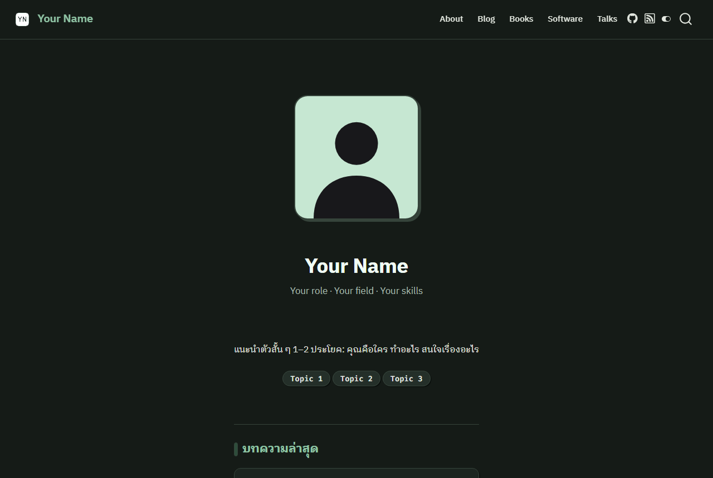
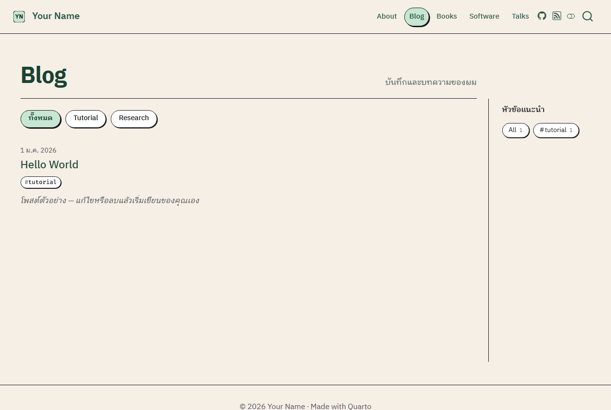
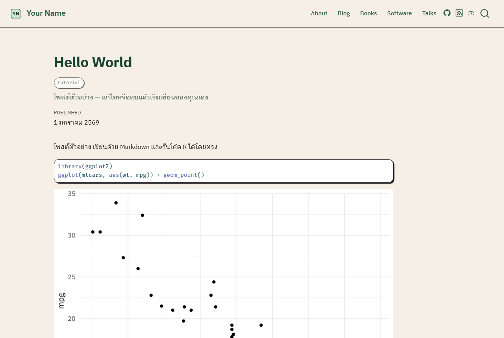
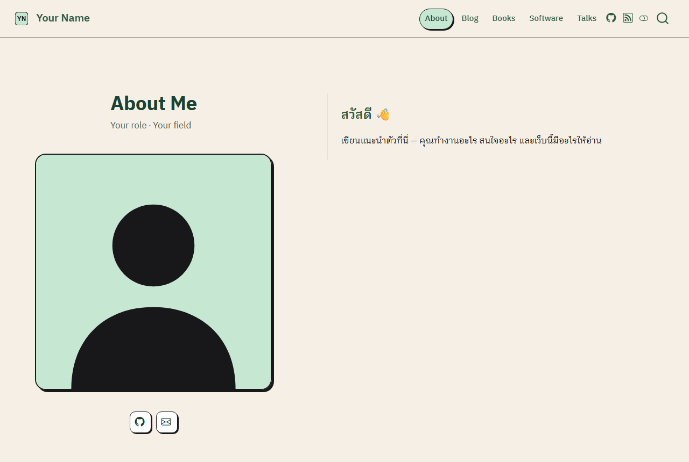

# kanthjs Quarto Site Template

Created by [Kanthanawit Jaisong](https://github.com/kanthjs) · ตัวอย่างเว็บจริง: [kanthanawit.in.th](https://kanthanawit.in.th)

Template เว็บไซต์ส่วนตัว/บล็อกด้วย [Quarto](https://quarto.org) — ธีม warm-paper, ฟอนต์ไทย IBM Plex Sans Thai Looped, dark mode, หน้า Blog / Books / Software / Talks และ deploy อัตโนมัติด้วย GitHub Actions

## ตัวอย่าง

| Light | Dark |
| :-: | :-: |
|  |  |

| Blog | Post | About |
| :-: | :-: | :-: |
|  |  |  |

## เริ่มใช้งาน

1. กด **Use this template** → **Create a new repository** (หรือ Fork)
2. ตั้งชื่อ repo เช่น `<username>.github.io` (หรือชื่ออะไรก็ได้)
3. ไปที่ **Settings → Pages → Build and deployment → Source: GitHub Actions**
4. แก้ค่าที่มีคอมเมนต์ `TODO` ในไฟล์ด้านล่าง แล้ว push เว็บจะ build และ deploy เอง

## สิ่งที่ต้องแก้ (TODO)

| ไฟล์ | แก้อะไร |
| :-- | :-- |
| `_quarto.yml` | `title`, `site-url`, `description`, ลิงก์ GitHub, footer |
| `index.qmd` | ชื่อ, subtitle, รูป, ลิงก์โซเชียล, ข้อความแนะนำตัว |
| `about/index.qmd` | หน้า About |
| `images/` | แทน `avatar.svg`, `logo.svg`, `favicon.svg` ด้วยของคุณ (ถ้าเปลี่ยนนามสกุล แก้ path ในไฟล์ qmd ด้วย) |
| `robots.txt` | URL ของ sitemap |
| `styles.scss` | สีธีม — แก้ตัวแปรใน `scss:defaults` ช่วงบนสุด |

ถ้าใช้ custom domain: สร้างไฟล์ `CNAME` ใส่โดเมน แล้วเพิ่ม `"CNAME"` ใน `project.resources`

## เพิ่มเนื้อหา

- **Blog post**: คัดลอก `_templates/post.qmd` ไปที่ `blog/YYYY-MM-DD-<slug>/index.qmd`
- **Book**: สร้าง `books/<slug>/index.qmd` (ดูตัวอย่างใน `books/example-book/`)
- **Talk**: คัดลอกบล็อก `talk-card` ใน `talks/index.qmd`
- **Software**: เพิ่ม `work-card` ใน `r-packages/index.qmd`
- หน้าใหม่ต้องเพิ่มใน `project.render` ของ `_quarto.yml` (และ navbar ถ้าต้องการ)
- ลบ `blog/2026-01-01-hello-world/` และ `books/example-book/` เมื่อมีเนื้อหาจริง

## เปลี่ยนภาษา

ค่าเริ่มต้นเป็นไทย (`lang: th`, `toc-title: "สารบัญ"`) ถ้าทำเว็บภาษาอังกฤษ ให้เปลี่ยนเป็น `lang: en` และ `toc-title: "Contents"` และแก้ข้อความไทยใน `blog/index.qmd`, `404.qmd`

## Build ในเครื่อง

ต้องติดตั้ง [Quarto](https://quarto.org/docs/get-started/) และ R (+ `ggplot2`, `showtext`, `sysfonts` ถ้าโพสต์ใช้โค้ด R)

```bash
quarto preview   # live-reload
quarto render    # build ลง _site/
```

`execute: freeze: true` — โค้ด R จะรันเฉพาะเมื่อไฟล์เปลี่ยน ผลลัพธ์เก็บใน `_freeze/` ให้ commit โฟลเดอร์นี้ด้วย เพื่อให้ GitHub Actions build ได้โดยไม่ต้องลง R

## โครงสร้าง

```text
├── _quarto.yml            # config เว็บ
├── styles.scss            # ธีม (light)
├── styles-dark.scss       # ธีม (dark)
├── header.html            # โหลดฟอนต์ Google Fonts
├── .Rprofile              # ตั้งฟอนต์ ggplot2
├── fonts/                 # ฟอนต์สำหรับกราฟ R
├── _templates/            # แม่แบบ post / talk / home list
├── blog/ books/ talks/ r-packages/ about/
└── .github/workflows/publish.yml
```

## License

MIT — ดู [LICENSE](LICENSE) ฟอนต์ IBM Plex Sans Thai Looped และ Fira Code ใช้ภายใต้ SIL Open Font License
